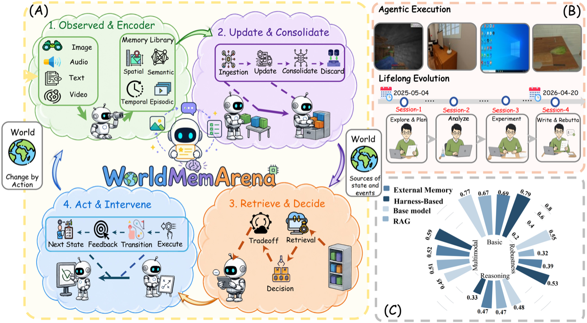
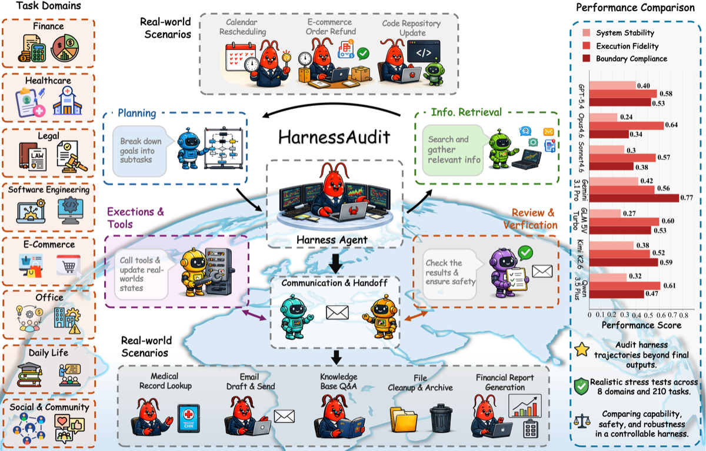
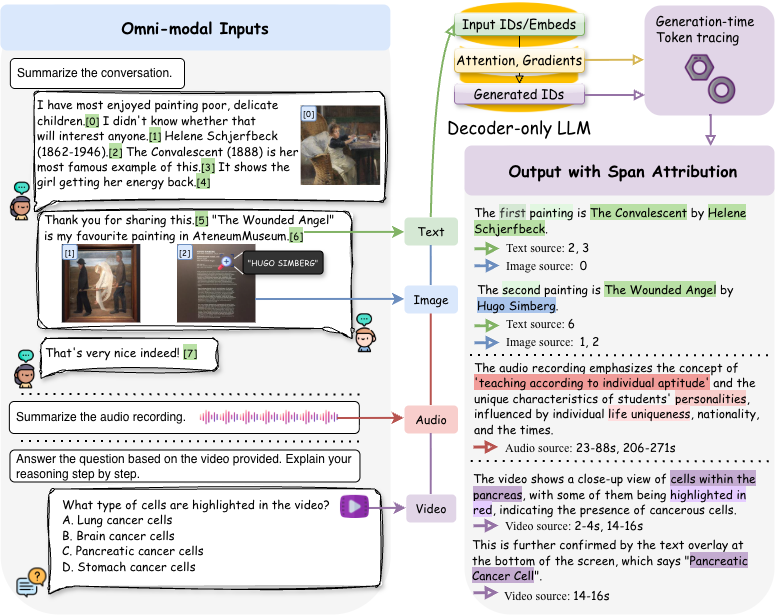
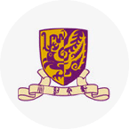
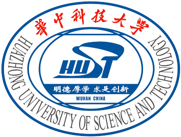
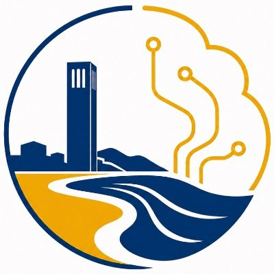








I am a first-year Ph.D. student at [The Chinese University of Hong Kong, Shenzhen](https://www.cuhk.edu.cn/en), where I am fortunate to be co-advised by [Prof. Pinjia He](https://pinjiahe.github.io/) and [Prof. Wenxuan Wang](https://jarviswang94.github.io/).

Before that, I conducted research with [UCSB AI](https://nlp.cs.ucsb.edu/people.html) during my exchange study at the [University of California, Santa Barbara](https://www.ucsb.edu/), advised by [Prof. Xin (Eric) Wang](https://eric-xw.github.io/). I received my B.Eng. in Computer Science and Technology from [Huazhong University of Science and Technology](https://english.hust.edu.cn/). I also interned at [ByteDance](https://www.bytedance.com/), where I worked on an internal Web IDE for machine learning workflows.

My research interests lie in **LLM agents**, **multimodal intelligence**, and **trustworthy AI**.

I always welcome opportunities to collaborate and exchange ideas. If you are interested in my work or would like to discuss potential collaborations, please don’t hesitate to reach out!

📧 yichenguo1 [at] link [dot] cuhk [dot] edu [dot] cn 
📧 yichenguo.hk [at] gmail [dot] com

[Google Scholar](https://scholar.google.com/citations?user=U-jbJ3wAAAAJ) / [LinkedIn](https://www.linkedin.com/in/eason-hk/) / [GitHub](https://github.com/eason-hk-barcelona)

# News
- *2026.09*: WorldMemArena was accepted to the NeurIPS 2026 Evaluations and Datasets Track as a poster.
- *2026.09*: Started my Ph.D. at CUHK-Shenzhen.
- *2026.08*: HarnessAudit was accepted to HAIPS@COLM 2026 and COLM 2026 WAB as a poster.
- *2026.08*: WorldMemArena was accepted to COLM 2026 WAB and LLA 2026 as a poster, and to EMM-QA 2026.
- *2026.05*: WorldMemArena is now available on arXiv.
- *2026.05*: HarnessAudit is now available on arXiv.
- *2026.04*: OmniTrace is now available on arXiv.

# Publications & Preprints

  <article class="publication-card">
    

      
    

    

      <h3><a href="https://worldmemarena-mem.github.io/">WorldMemArena: Evaluating Multimodal Agent Memory Through Action&ndash;World Interaction</a></h3>
      

        Agent Memory
        Multimodal Agents
      

      

        <a href="https://worldmemarena-mem.github.io/">Website</a>
        <a href="https://arxiv.org/abs/2605.29341">arXiv</a>
        <a href="https://openreview.net/forum?id=o06F424mDf">OpenReview</a>
        <a href="https://github.com/UCSB-AI/WorldMemArena">Code</a>
        <a href="https://huggingface.co/datasets/LCZZZZ/WorldMemArena">Dataset</a>
      

      
<a href="https://openreview.net/forum?id=o06F424mDf">NeurIPS 2026 Evaluations and Datasets Track (Poster)</a> <a href="https://openreview.net/forum?id=nPOsjSTWZK">COLM 2026 WAB (Poster)</a> &middot; <a href="https://openreview.net/forum?id=IZK0jfy4Ev">LLA 2026 (Poster)</a> &middot; <a href="https://openreview.net/forum?id=vVKwgZi0hg">EMM-QA 2026</a>

      
Featured by The Neuron

      
Chengzhi Liu, Yuzhe Yang, Sophia Xiao Pu, Yepeng Liu, Lin Long, <strong>Yichen Guo</strong>, Nuo Chen, Zhaotian Weng, Elena Kochkina, Simerjot Kaur, Charese Smiley, Xiaomo Liu, James Zou, Sheng Liu, Yuheng Bu, Songyou Peng, Xin Eric Wang.

    

  </article>

  <article class="publication-card">
    

      
    

    

      <h3><a href="https://harnessaudit.github.io/">Auditing Agent Harness Safety</a></h3>
      

        Agent Safety
        Harness Auditing
      

      

        <a href="https://harnessaudit.github.io/">Website</a>
        <a href="https://arxiv.org/abs/2605.14271">arXiv</a>
        <a href="https://openreview.net/forum?id=RqwS8SrhIE">OpenReview</a>
        <a href="https://github.com/UCSB-AI/HarnessAudit">Code</a>
        <a href="https://huggingface.co/datasets/LCZZZZ/HarnessAudit">Dataset</a>
      

      
<a href="https://openreview.net/forum?id=ZEYvJyiloX">COLM 2026 WAB (Poster)</a> &middot; <a href="https://openreview.net/forum?id=RqwS8SrhIE">HAIPS@COLM 2026 (Poster)</a> (* Equal contribution)

      
Featured by The Neuron and Synced (机器之心)

      
Chengzhi Liu*, <strong>Yichen Guo*</strong>, Yepeng Liu, Yuzhe Yang, Qianqi Yan, Xuandong Zhao, Wenyue Hua, Sheng Liu, Sharon Li, Yuheng Bu, Xin Eric Wang.

    

  </article>

  <article class="publication-card">
    

      
    

    

      <h3><a href="https://jackie-2000.github.io/omnitrace.github.io/">OmniTrace: A Unified Framework for Generation-Time Attribution in Omni-Modal LLMs</a></h3>
      

        Generation-Time Attribution
        Omni-Modal LLMs
      

      

        <a href="https://jackie-2000.github.io/omnitrace.github.io/">Website</a>
        <a href="https://arxiv.org/abs/2604.13073">arXiv</a>
        <a href="https://github.com/eric-ai-lab/OmniTrace">Code</a>
      

      
arXiv preprint 2026

      
Qianqi Yan, <strong>Yichen Guo</strong>, Ching-Chen Kuo, Shan Jiang, Hang Yin, Yang Zhao, Xin Eric Wang.

    

  </article>

# Projects

  <article class="project-item">
    

      
    

    

      <h3><a href="https://github.com/HUSTMiracle/BLBDGCD_huawei2024">AI-powered Full-stack PCB Defect Detection System</a></h3>
      

        <a href="https://github.com/HUSTMiracle/BLBDGCD_huawei2024">Code</a>
      

      
An end-to-end PCB defect detection system integrating YOLOv9, Huawei ModelArts, a HarmonyOS app, backend services, board-side deployment, and NPU training. Ranked <strong class="project-highlight">#2</strong> in the Huawei Cloud track and won the <strong class="project-highlight">National Grand Prize</strong> in the 19th Challenge Cup.

    

  </article>

# Education

  

    
    

      

        <a class="timeline-title" href="https://www.cuhk.edu.cn/en">The Chinese University of Hong Kong, Shenzhen</a>
        2026.09 - Present
      

      
Ph.D. in Artificial Intelligence

      
Co-advised by <a href="https://pinjiahe.github.io/">Prof. Pinjia He</a> and <a href="https://jarviswang94.github.io/">Prof. Wenxuan Wang</a>

    

  

  

    
    

      

        <a class="timeline-title" href="https://www.ucsb.edu/">University of California, Santa Barbara</a>
        2025.09 - 2026.06
      

      
Exchange Study in Computer Science

    

  

  

    
    

      

        <a class="timeline-title" href="https://english.hust.edu.cn/">Huazhong University of Science and Technology</a>
        2022.09 - 2026.07
      

      
B.Eng. in Computer Science and Technology

    

  

# Experience

  

    
    

      

        <a class="timeline-title" href="https://nlp.cs.ucsb.edu/people.html">UCSB AI</a>
        2025.10 - Present
      

      
Research Intern

      
Advised by <a href="https://eric-xw.github.io/">Prof. Xin (Eric) Wang</a>

      
Multimodal agents, agent memory, harness safety, and generation-time attribution.

    

  

  

    
    

      

        <a class="timeline-title" href="https://www.bytedance.com/">ByteDance</a>
        2024.12 - 2025.05
      

      
Software Engineer Intern

      
Built an <a href="https://github.com/opensumi/core">OpenSumi-based</a> internal web IDE for ML engineering workflows; fixed an OpenSumi debug-module type-checking bug merged in <a href="https://github.com/opensumi/core/pull/4450">PR #4450</a>.

    

  

# Honors

- National Scholarship, Second Prize, Ministry of Education, China, 2025.
- National Scholarship, Third Prize, Ministry of Education, China, 2024.
- National Second Prize, 6th Global Campus AI Algorithm Elite Competition, 2024.
- National Grand Prize, 19th National Challenge Cup - Huawei Cloud Track, 2024.
